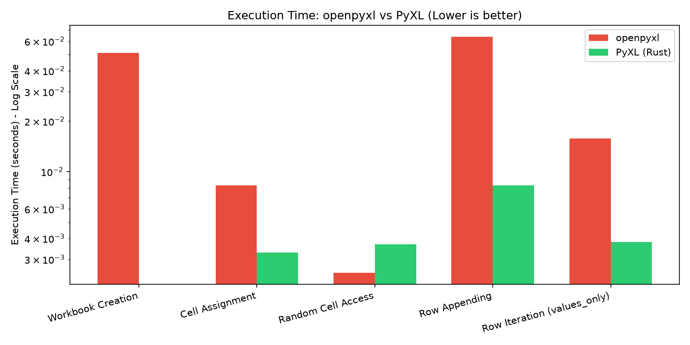
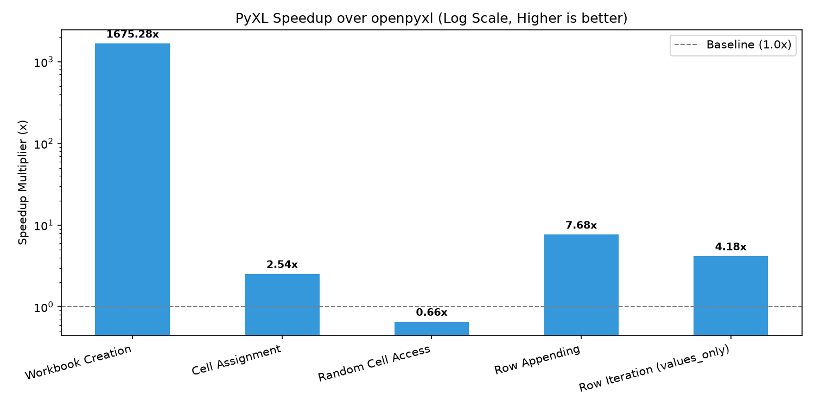
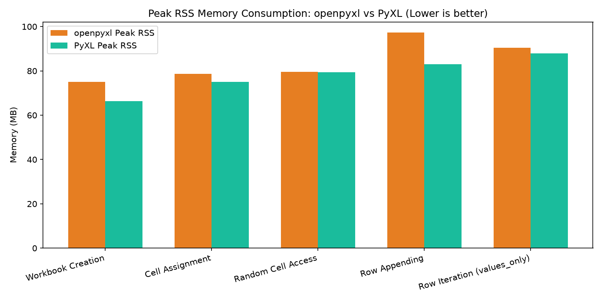

# Phase 1 Comparative Benchmark Report: PyXL vs openpyxl

Generated at: 2026-10-20 10:27:48 UTC

Environment: Linux (aarch64), 8 Cores, 3916.36 MB RAM

## Performance Comparison Table

| Operation | Dataset | openpyxl (s) | PyXL (s) | Speedup | openpyxl RSS (MB) | PyXL RSS (MB) | Mem Reduction | PyXL Throughput |
|---|---|---|---|---|---|---|---|---|
| Workbook Creation | 200 workbooks | 0.0512s | 0.0s | **1675.28x** | 75.04 | 66.37 | 11.6% | 6,548,574.0 workbooks/s |
| Cell Assignment | 1000x10 (10,000 cells) | 0.0083s | 0.0033s | **2.54x** | 78.66 | 75.05 | 4.6% | 3,073,337.2 cells/s |
| Random Cell Access | 10,000 lookups | 0.0025s | 0.0037s | **0.66x** | 79.66 | 79.32 | 0.4% | 2,708,559.0 reads/s |
| Row Appending | 5,000 rows (50,000 cells) | 0.0637s | 0.0083s | **7.68x** | 97.27 | 82.93 | 14.7% | 602,848.5 rows/s |
| Row Iteration (values_only) | 5,000 rows (50,000 cells) | 0.0158s | 0.0038s | **4.18x** | 90.36 | 87.98 | 2.6% | 13,258,643.0 cells/s |

## Performance Graphs

### Execution Time (Log Scale)

### Speedup Factor

### Peak Memory Utilization (RSS)

