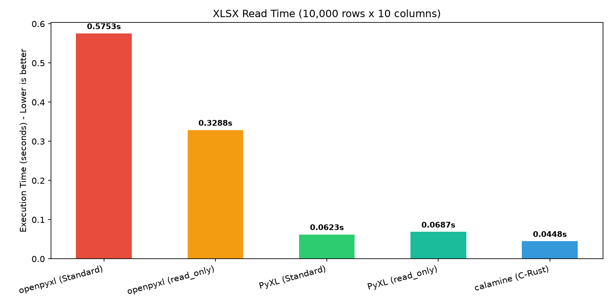
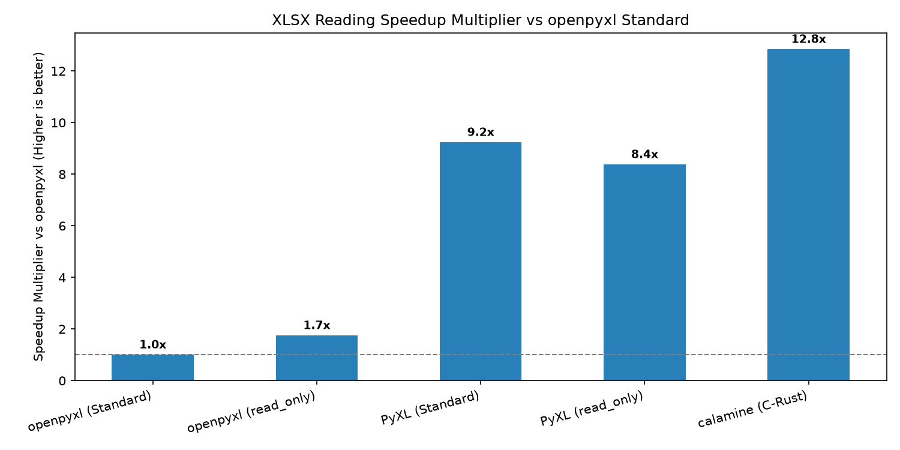
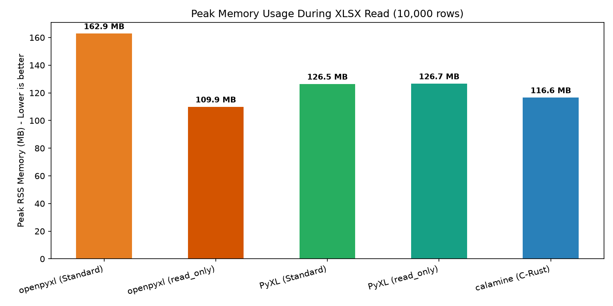

# PyXL Comprehensive Benchmark Report (Phase 1 & Phase 2)

Generated at: 2026-10-20 11:51:31 UTC

**Environment**: Linux (aarch64), 8 Cores, 3916.36 MB RAM

## 1. Phase 2: High-Performance XLSX Reader Benchmarks

Dataset: `10,000 rows x 10 columns` (100,000 cells) containing strings, floats, ints, bools, and datetimes.

| Operation | openpyxl | PyXL | Speedup | openpyxl RSS | PyXL RSS | PyXL Throughput |
|---|---|---|---|---|---|---|
| Full XLSX Read (Standard) | 0.5609s | 0.0617s | **9.09x** | 163.0 MB | 133.2 MB | 162,059 rows/s |
| Full XLSX Read (read_only=True) | 0.3171s | 0.0704s | **4.51x** | 121.5 MB | 122.9 MB | 142,142 rows/s |
| Time to First Row (read_only=True) | 3.00 ms | 0.94 ms | **3.21x** | 128.2 MB | 137.6 MB | Instantaneous |
| Time to First Row (Standard vs RO) | 517.06 ms | 0.94 ms | **552.6x** | 166.8 MB | 137.6 MB | Instantaneous |
| Calamine Full Read Baseline | 0.5609s (openpyxl std) | 0.0455s (calamine) | **12.33x** | 163.0 MB | 134.3 MB | 219,862 rows/s |

### Phase 2 Performance Graphs

#### 1. Total Reading Execution Time (10,000 rows)

#### 2. Speedup Factor over openpyxl

#### 3. Peak RSS Memory Utilization

## 2. Phase 1: In-Memory Operations Benchmarks

| Operation | Dataset | openpyxl (s) | PyXL (s) | Speedup | openpyxl RSS | PyXL RSS | Mem Reduction | PyXL Throughput |
|---|---|---|---|---|---|---|---|---|
| Workbook Creation | 200 workbooks | 0.0515s | 0.0s | **1431.78x** | 75.66 MB | 67.01 MB | 11.4% | 5,561,889.9 workbooks/s |
| Cell Assignment | 1,000x10 (10,000 cells) | 0.0083s | 0.0046s | **1.81x** | 78.21 MB | 75.66 MB | 3.3% | 2,175,115.0 cells/s |
| Row Appending | 5,000 rows (50,000 cells) | 0.051s | 0.0075s | **6.83x** | 98.79 MB | 80.42 MB | 18.6% | 669,094.1 rows/s |
| In-Memory Row Iteration | 5,000 rows (50,000 cells) | 0.016s | 0.004s | **3.95x** | 94.32 MB | 96.3 MB | -2.1% | 12,396,950.4 cells/s |
